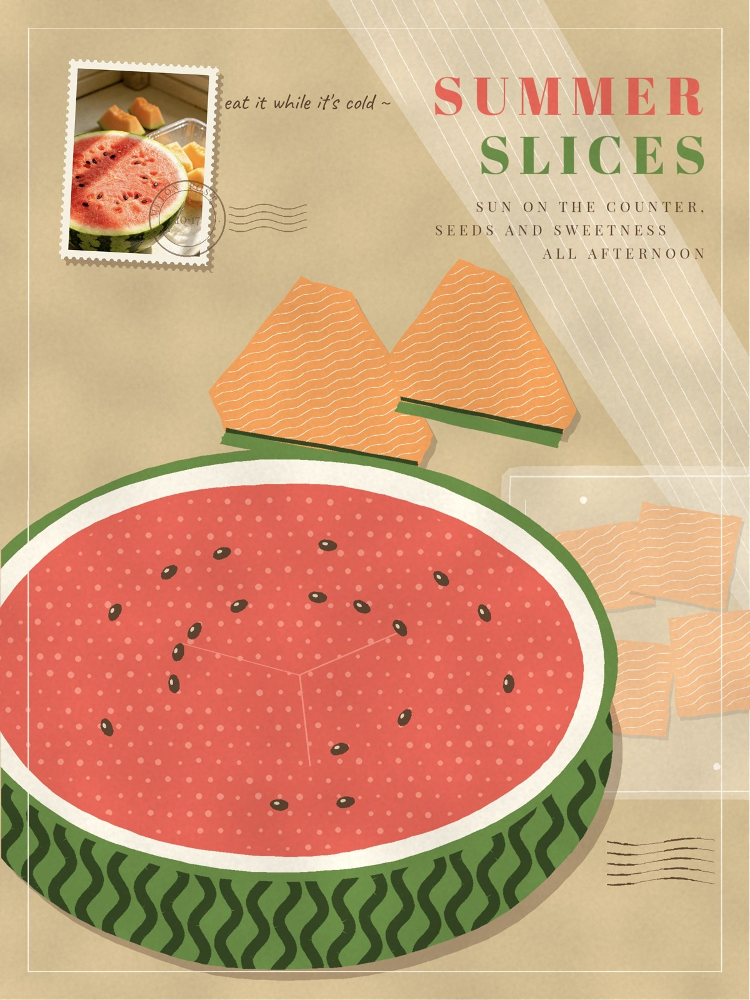
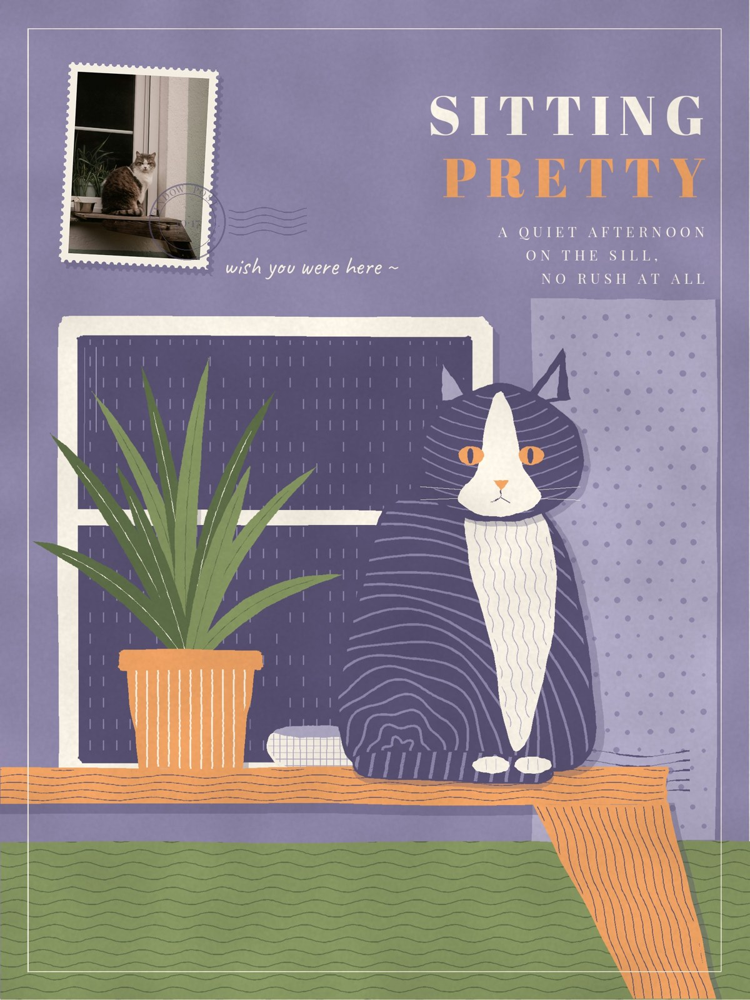

# Stamp Print · 邮票印花 📮

> 一张照片 → 一张 3:4 复古套色剪纸海报。
> **全部由代码一笔一笔画出来，不用任何生图模型。**

| SUMMER SLICES | SITTING PRETTY |
| :---: | :---: |
|  |  |

## ✂️ 它长什么样

- **满铺剪纸插画**：哑光平涂、剪刀边、轻微套色错位、纯色平涂投影，前 / 中 / 后三层。
- **一枚小邮票**：左上角贴一张 3:4 齿孔邮票，里面是原照片本身，再盖一枚半透明邮戳。
- **细细的纹样**：波浪线、直条、同心弧、小格、打孔圆点、短虚线，和整块纯色交替出现。
- **颜色跟着照片走**：每张都从照片里取色，蓝天就是蓝、西瓜就是红，只压成哑光，不套固定色板。
- **复古排版**：Abril Fatface 大标题 + Playfair 小字短句 + 一句手写批注。

## 🚀 快速开始

```bash
pip install -r requirements.txt
python examples/melon.py   # → examples/melon_poster.jpg
python examples/cat.py     # → examples/cat_poster.jpg
```

画布 900×1200 设计坐标，输出 **1800×2400**，单张约 30 秒，只依赖 numpy / scipy / Pillow。

## 🤖 让 AI 帮你画

把仓库交给会写代码的 AI（Claude、GPT、Cursor 等），再发一张照片：

> 读一下 SKILL.md，用 Stamp Print 把这张照片做成一张邮票印花海报。

AI 会按 [SKILL.md](SKILL.md) 的流程：看照片 → 取色 → 写场景脚本 → 渲染 → 自己看图修正 → 交付。

## 📁 目录

```
SKILL.md               风格规则、取色方法、流程、API 速查（AI 从这里开始）
stamp_print/stamp.py   绘图引擎
stamp_print/fonts/     四款开源字体（SIL OFL）
examples/              场景脚本 + 示例照片
gallery/               成品
```

## English

**Stamp Print** turns a photo into a 3:4 retro cut-paper poster, drawn entirely in Python code (no image-generation model). Matte flat colors, scissor-cut edges, slight print misregistration, flat drop shadows, fine line patterns, and a perforated 3:4 stamp of the original photo with a translucent postmark. The palette is sampled from each photo, keeping its signature hues. Start with [SKILL.md](SKILL.md).

## 许可 License

代码与文档：MIT ｜ 字体：SIL OFL 1.1 ｜ 示例照片另有条款，见 [THIRD_PARTY_NOTICES.md](THIRD_PARTY_NOTICES.md)。

Made by **Qisi 绮思** × **Lan 澜**
